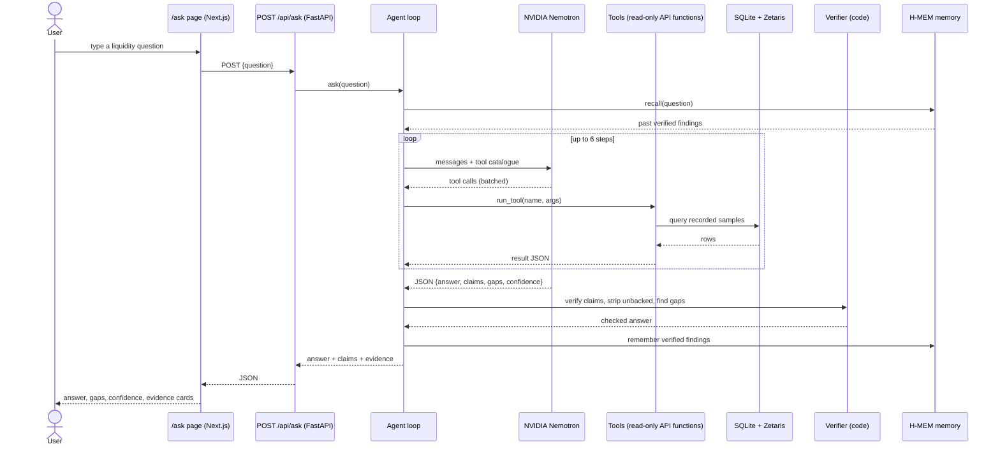

# Follow: an investigator agent for market liquidity

> **Ask a liquidity question. Get an answer where every number is traced to a recorded measurement, the gaps in the data are named, and the confidence is lowered when the data is thin.**

Built for the **Open Agent Hackathon 2026** (NVIDIA Nemotron, Zetaris, Meterless). It sits on top of a real recorder that has been watching Strike's order book, Binance and Hyperliquid since the Strike hackathon. No mocked data, no simulated books.

- [1. The idea](#1-the-idea)
- [2. How it works](#2-how-it-works)
- [3. The honesty layer](#3-the-honesty-layer)
- [4. Using the app](#4-using-the-app)
- [5. Run it yourself](#5-run-it-yourself)
- [6. Sponsor technologies](#6-sponsor-technologies)
- [7. The data underneath](#7-the-data-underneath)
- [8. Repository layout](#8-repository-layout)
- [9. Honest limits](#9-honest-limits)

---

## 1. The idea

**The problem.** "Is Strike liquid enough to trade $100k?" is a question traders and market makers ask constantly. The usual answers are a screenshot, a dashboard number with no source, or a language model's confident paragraph. A model with no access to data invents numbers. A model with access can still misread them, round them, or quietly skip the part of the day when the feed was down.

**The approach.** Follow splits the job in two and does not let the language model grade its own work:

1. The **agent** (NVIDIA Nemotron) decides which measurements to fetch, by calling a small set of read-only tools (coverage, scorecard, series, gaps, resilience, toxicity, cancel_fill, plus an optional Zetaris summary).
2. The **verifier** (plain code, no model) checks every claim the agent makes against what the tools actually returned. A sentence with a number that no tool produced is removed. Gaps in the recording that overlap the question are attached. Confidence is lowered when they do.

So the output is not "what the model thinks". It is *what the recorder measured, as far as the checks could confirm*, with the model doing the reading and the code doing the policing.

**What you get for each question**

| Part | Meaning |
|---|---|
| Answer | Short prose, only sentences backed by a claim |
| Claims | Each: text, tool used, arguments, the value returned |
| Gaps affecting the answer | Recording gaps that overlap the window asked about |
| Confidence | high / medium / low, lowered by gaps and by unbacked claims |
| Evidence cards | The raw tool results, with a small chart |

**Example.** *"How much slippage would a $50k market buy take on Strike versus Binance?"* The agent calls the slippage tool for both venues, writes two claims with the returned values, the verifier confirms them, finds no gap in the window, and returns `confidence: high`. If the Strike recorder was offline for 40 minutes inside the window, the same question returns the same numbers with `confidence: medium` and the 40-minute gap listed.

---

## 2. How it works

### 2.1 Sequence of one question



### 2.2 System architecture

```
 Browser
   |  /ask  /scorecard  /designer  /methodology  /data
   v
+-----------------------+          +------------------------------------+
|  Next.js front end    |  HTTPS   |  FastAPI  (follow/api.py)          |
|  (web/)               |--------->|  read-only endpoints + /api/ask    |
+-----------------------+          +----------------+-------------------+
                                                    |
                              +---------------------+----------------------+
                              |                                            |
                    +---------v----------+                     +-----------v-----------+
                    |  Agent             |                     |  Metrics engine       |
                    |  follow/agent.py   |-- tools call ------>|  follow/metrics.py    |
                    |  verify + strip    |                     |  spread, depth,       |
                    +----+-----------+---+                     |  slippage, cancels,   |
                         |           |                         |  resilience, toxicity |
              +----------v--+   +----v-----------+             +-----------+-----------+
              | NVIDIA      |   | H-MEM subset   |                         |
              | Nemotron    |   | follow/hmem.py |             +-----------v-----------+
              | (chat API)  |   +----------------+             |  SQLite  (recorded)   |
              +-------------+                                  |  samples, events,     |
                         |                                     |  gaps, rollups        |
              +----------v-------------+                       +-----------^-----------+
              | Zetaris (optional)     |<-- Parquet export ---+            |
              | SQL over book_samples  |                       |  +---------+-----------+
              +------------------------+                       +--|  Recorder (24/7)    |
                                                                  |  Strike L3 + WS     |
                                                                  |  Binance, Hyperliq. |
                                                                  +---------------------+
```

### 2.3 The agent loop

```
 question
    |
    v
 recall past findings (H-MEM, relevance >= 0.35)
    |
    v
 +-----------------------------------------------+
 |  step 1..6                                    |
 |   model sees: question + memory + tool list   |
 |        |                                      |
 |        +-- tool calls?  yes --> run all of them in one batch
 |        |                         append results, next step
 |        +-- no  --> final JSON answer          |
 +-----------------------------------------------+
    |
    v
 bad JSON?  -> one repair attempt, then give up honestly
    |
    v
 verifier (section 3) -> final response
```

Why max 6 steps: each step is a network round trip to the model. Six is enough for a three-venue comparison with a gap check, and bounds the cost of a bad question.

### 2.4 The front end flow

```
 /ask
  |
  |-- 5 suggested questions (click to fill)
  |-- question box --> POST /api/ask --> spinner
  |                                          |
  |            +-----------------------------+
  |            v
  |   [ answer banner + confidence badge ]
  |   [ gaps box: "Strike L3 offline 02:10-02:50" ]
  |   [ evidence cards: tool, args, value, mini chart ]
  |
  +-- every number in the banner appears again in a card below it
```

---

## 3. The honesty layer

All of this is ordinary code in [follow/agent.py](follow/agent.py), covered by tests in [tests/test_agent.py](tests/test_agent.py).

```
 model's claims                        tool results from this question
 [{text, tool, args, value}, ...]      {tool, args} -> result JSON
          \                                    /
           \                                  /
            v                                v
        +----------------------------------------+
        |  verify(claim)                         |
        |   - tool+args were really called?      |
        |   - value found in that result?        |
        |   - tolerant to 12%, 12.0%, 1.2k,      |
        |     993 ms vs 0.993 s                  |
        +--------------------+-------------------+
                             |
          claim ok? ---- no ---> claim dropped
                             |
                             v
        +----------------------------------------+
        |  strip_unbacked(answer)                |
        |   every sentence with a number must be |
        |   backed by a verified claim, or the   |
        |   number must come from the question   |
        |   ("$50k") or the tool args            |
        +--------------------+-------------------+
                             |
                             v
        +----------------------------------------+
        |  gaps_affecting(window)                |
        |   intersect the question's time window |
        |   with the recorder's gap table        |
        +--------------------+-------------------+
                             |
                             v
        confidence = model's, lowered one level per
        gap overlap or removed sentence
```

Design rule: **the model may be wrong; the output may not be silently wrong.** If the checks remove everything, the answer says so rather than falling back to the model's prose.

A claim, as returned to the client:

```json
{
  "text": "Strike spread is under 5 bps 91% of the time",
  "tool": "scorecard",
  "args": {"window_minutes": 60},
  "value": 0.91
}
```

---

## 4. Using the app

### 4.1 In the browser

1. Open the **Ask** page.
2. Click a suggested question or type your own. Good questions name a venue, a size or a window: *"Compare Binance and Strike depth within 10 bps"*, *"What happened to Strike's spread uptime in the last hour?"*.
3. Wait a few seconds (a typical question takes 2 to 4 model calls).
4. Read in this order:
   - **Confidence badge.** Low means: read the gaps box before trusting any number.
   - **Gaps box.** Time ranges where the recorder was not watching. Numbers around them are measured on what was recorded, never interpolated.
   - **Answer.** Each number is also in an evidence card.
   - **Evidence cards.** Tool name, arguments and the value. If you disagree with an answer, this is where to check it.
5. If an answer is shorter than you expected, that is the verifier removing a sentence it could not back. Ask again more narrowly.

### 4.2 From the command line

```bash
curl -s -X POST http://localhost:8010/api/ask \
  -H "Content-Type: application/json" \
  -d '{"question":"How deep is Strike BTC within 10 bps right now?"}'
```

Response (shortened):

```json
{
  "answer": "Strike shows about $210k of resting depth within 10 bps ...",
  "claims": [{"text": "...", "tool": "scorecard", "args": {"window_minutes": 60}, "value": 210000}],
  "gaps_affecting_answer": [],
  "confidence": "high",
  "evidence": [{"tool": "scorecard", "args": {"window_minutes": 60}, "result": {"...": "..."}}]
}
```

Errors: `503` no model key configured; `502` the model or a tool failed (the message says which); `429` rate limit (12 questions per hour per IP).

### 4.3 Other pages

| Page | What it is for |
|---|---|
| `/scorecard` | The six metrics per venue, with `compare=prev|day|week` |
| `/designer` | Test incentive-program settings against the recorded book |
| `/methodology` | Exact definitions and how gaps are handled |
| `/data` | Download the Parquet export of recorded samples |

---

## 5. Run it yourself

Requirements: Python 3.11+, Node 20+, a recorded database (or the bundled snapshot), and an NVIDIA API key.

```bash
git clone https://github.com/SamuelDharshi/follow.git
cd follow
python -m venv .venv && source .venv/bin/activate     # Windows: .venv\Scripts\activate
pip install -r requirements.txt
cp .env.example .env                                   # then fill in the keys below
```

| Variable | Needed | Meaning |
|---|---|---|
| `NVIDIA_API_KEY` | yes | Key for `https://integrate.api.nvidia.com/v1` |
| `AGENT_MODEL` | no | Default `nvidia/nemotron-3.5-lightning-30b-a3b`. Leave blank for default |
| `FOLLOW_DB` | yes* | Path to the recorded SQLite file |
| `SNAPSHOT_MODE` | no | `1` serves `snapshot/follow-snapshot.db` read-only (*replaces `FOLLOW_DB`) |
| `FOLLOW_EXPORT_DIR` | no | Where Parquet exports are written |
| `ZETARIS_BASE_URL`, `ZETARIS_ORG_ID`, `ZETARIS_USERNAME`, `ZETARIS_PASSWORD`, `ZETARIS_SAMPLES_TABLE` | no | Enables the `zetaris_depth_summary` tool; hidden from the agent until all are set |
| `ZETARIS_API_KEY` | no | Optional token; login credentials are the fallback |
| `API_PORT` | no | Default 8000; examples below use 8010 |

**Backend, no recorder (uses the snapshot):**

```bash
SNAPSHOT_MODE=1 API_PORT=8010 python -m follow.api
```

**Backend with live recording** (needs outbound access to Strike, Binance and Hyperliquid):

```bash
python -m follow.recorder          # records Strike, Binance and Hyperliquid
API_PORT=8010 python -m follow.api
```

**Front end:**

```bash
cd web
npm install
NEXT_PUBLIC_API_URL=http://localhost:8010 npm run dev -- -p 3010
```

Open `http://localhost:3010/ask`.

**Optional: Zetaris locally.** Start the Zetaris Docker bundle (UI on 3000, API on 8888), set the five `ZETARIS_*` variables, then load the samples once:

```bash
python -m follow.export            # writes Parquet under FOLLOW_EXPORT_DIR
# create the table over the Parquet file with Zetaris DDL (JDBC), e.g.
# CREATE LIGHTNING FILESTORE TABLE follow.book_samples ... FORMAT PARQUET OPTIONS (PATH '...')
```

The REST endpoint only accepts `SELECT`, so DDL goes through JDBC (see [FEEDBACK.md](FEEDBACK.md)).

**Tests:**

```bash
pytest -q          # 21 tests: metrics, real-data checks, agent honesty rules
```

**Troubleshooting**

| Symptom | Cause |
|---|---|
| `/api/ask` returns 503 | `NVIDIA_API_KEY` not set |
| Answer says nothing, confidence low | The verifier removed every unbacked sentence; ask a narrower question |
| Model call returns 404 or 410 | Model not enabled or retired for your key; set `AGENT_MODEL` to one that is |
| Empty model replies, slow | Thinking mode on; Follow turns it off for NVIDIA by default |
| Web page says "Cannot reach the API" | `NEXT_PUBLIC_API_URL` wrong or API not running |

---

## 6. Sponsor technologies

| Sponsor | Used? | How, and how deeply |
|---|---|---|
| **NVIDIA** | Yes, core | Nemotron (`nvidia/nemotron-3.5-lightning-30b-a3b`) through the hosted OpenAI-compatible API runs the tool-calling loop. Thinking mode is switched off per request (it exhausted the token budget). |
| **Zetaris** | Yes, optional tool | A local Zetaris platform queries a Parquet export of 104,664 book samples through SQL, exposed to the agent as `zetaris_depth_summary`. The data is a one-time snapshot, not live. |
| **Meterless** | Partly | `follow/hmem.py` implements a Python subset of the H-MEM spec: tiers (0.6, 0.8, 1.0 weights), required source/confidence/provenance, supersession, retrieval threshold 0.35. It is not Meterless's engine and has not been conformance-tested. |
| **SpaceX AI** | No | Not used. |

What we found building with them, and a proposed fix, is in [FEEDBACK.md](FEEDBACK.md); [scripts/probe_sponsors.py](scripts/probe_sponsors.py) reproduces it.

---

## 7. The data underneath

```
 Strike L3 feed ----+                  one number's journey
 Strike /ws/price --+--> recorder ---> raw events (exchange timestamps)
 Binance -----------+        |                |
 Hyperliquid -------+        |                v
                             |        burst-aware 2-second samples
                             |                |
                  sequence gap?               v
                  mark gap, re-snapshot   rollups (1m / 1h / 1d)
                  never interpolate           |
                                              v
                              metric function -> API -> agent tool -> claim -> UI
```

- **Strike L3.** REST snapshot plus WebSocket with per-symbol sequence numbers. A skipped sequence number writes a gap row and triggers a fresh snapshot.
- **Burst-aware sampling.** Strike refreshes its whole book about once a second as roughly 190 unbracketed events (measured: median resting time 993 ms; 32% of bursts end state-neutral). Samples are taken only once 50 ms of quiet has passed on exchange timestamps, so a sample never lands mid-refresh.
- **Metrics.** M1 spread uptime, M2 depth within 5/10/25 bps, M3 slippage at $10k/$50k/$100k, M4 cancel/fill, M5 depth resilience, M6 flow toxicity. Definitions in `/methodology`.
- **Binance** uses futures with a spot-mirror fallback when the main domain is blocked; **Hyperliquid** uses `l2Book` at two granularities.

---

## 8. Repository layout

```
follow/
  agent.py         tool catalogue, model backends, verification, ask() loop
  hmem.py          H-MEM-shaped memory subset (JSON file next to the DB)
  zetaris.py       Zetaris REST client (login, SELECT, numeric coercion)
  api.py           FastAPI app incl. POST /api/ask
  metrics.py       M1-M6
  recorder.py, strike_l3.py, strike_market.py, binance.py, hyperliquid.py
  book.py, ladder.py, resample.py, analyze_churn.py, snapshot.py
  designer.py, export.py, verify.py, db.py, config.py, supervisor.py, status.py
tests/             test_agent.py, test_ladder.py, test_real_data.py
scripts/           probe_sponsors.py
web/               Next.js front end (see web/README.md)
snapshot/          read-only recorded database for SNAPSHOT_MODE
deploy/, Dockerfile, docker-compose.yml, render.yaml   packaging
FEEDBACK.md        sponsor-technology findings and proposed fix
```

---

## 9. Honest limits

- **Answer quality is uneven.** Some answers cite only one tool; occasionally the model returns no claims and the answer is empty; "takers" style questions can be over-trimmed by the verifier.
- **The mini chart is always spread uptime**, whatever the claim is about.
- **The verifier checks that a number was returned by a tool, not that the model drew the right conclusion from it.**
- **Zetaris data is a snapshot**, refreshed by hand.
- **Meterless support is a re-implementation of a subset**, not Meterless's software.
- **Recorded history has gaps** (laptop sleep, network loss). They are stored and reported, never filled in.
- **Rate limit** of 12 questions per hour per IP on `/api/ask`.
- **Not financial advice.** Liquidity measured on past recorded samples says nothing certain about the next trade.
